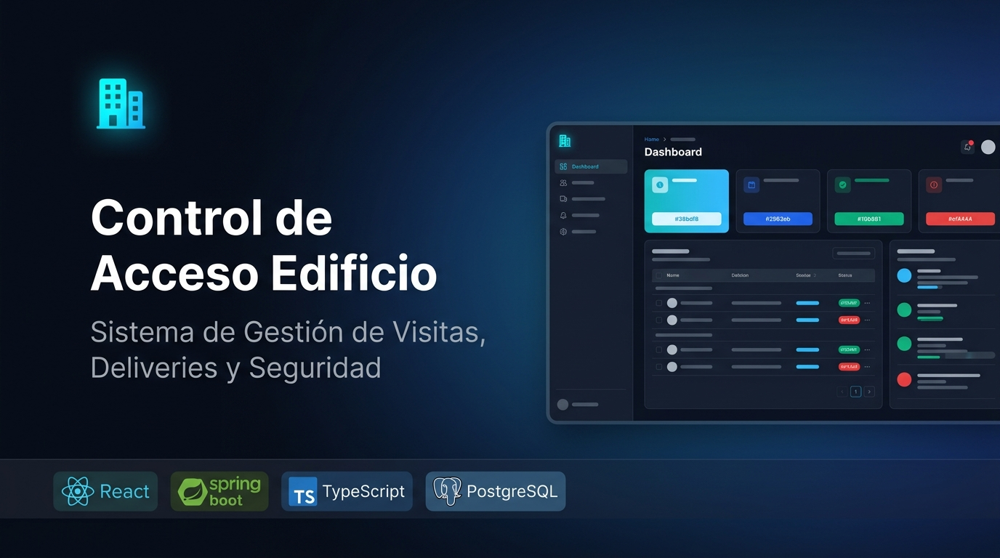

# 🏢 Control de Acceso — Conserjería Central



<p align="center">
  <strong>Sistema integral desktop-first para mesón de conserjería y administración de edificios residenciales.</strong>
  <br />
  <em>Optimizado para acelerar la atención de 2 minutos a menos de 20 segundos por visitante mediante diseño keyboard-first.</em>
</p>

<p align="center">
  
  
  
  
  
  
</p>

---

## Tabla de Contenidos

1. [Descripción General](#-descripción-general)
2. [Características Principales](#-características-principales)
3. [Stack Tecnológico](#-stack-tecnológico)
4. [Arquitectura del Sistema](#-arquitectura-del-sistema)
5. [Seguridad y Modo Demostración](#-seguridad-y-modo-demostración)
6. [Credenciales Demo](#-credenciales-demo)
7. [Atajos de Teclado (Keyboard-First)](#-atajos-de-teclado-keyboard-first)
8. [Instalación y Despliegue Local](#-instalación-y-despliegue-local)
9. [Estructura del Proyecto](#-estructura-del-proyecto)
10. [Licencia](#-licencia)

---

## Descripción General

**Control de Acceso** es una solución web orientada a la operación en tiempo real en la recepción o mesón de edificios corporativos y residenciales. Elimina el cuaderno de actas en papel y centraliza el control de:

- **Visitas de personas**: Validación con algoritmo de RUT chileno (Módulo 11), historial de visitas recurrentes y máquina de estados (`EN_ESPERA` ➔ `AUTORIZADO` / `RECHAZADO` ➔ `FINALIZADO`).
- **Directorio & Citofonía**: 18 pisos con 4 departamentos por piso (72 departamentos en total), con filtros rápidos y predictivos.
- **Deliveries & Paquetería**: Registro en recepción con entrega inmediata o custodia con código asignado (`#PAQ-XXX-XX`).
- **Alertas de Seguridad & Lista Negra**: Bloqueo o advertencia inmediata ante personas con órdenes judiciales o incidentes previos.
- **Monitor de Aforo en Tiempo Real (F9)**: Dashboard de evacuación ante siniestros o emergencias que totaliza las personas actualmente dentro del recinto piso por piso.
- **Bitácora de Novedades**: Registro inmutable por turnos (Mañana, Tarde, Noche) con categorización de incidentes.

---

## Características Principales

### 1. Directorio & Citofonía Inteligente

- Selector rápido por botones de piso (`P1` al `P18`) y tarjetas interactivas de departamentos.
- Búsqueda en tiempo real por número de departamento, nombre de residente titular o teléfono.
- Notas operativas visibles directamente en el panel (_"Llamar antes de las 22:00"_, _"Autoriza delivery a puerta"_).

### 2. Flujo de Visitas Keyboard-First

- Autocompletado instantáneo si el visitante ya está registrado en el histórico del edificio.
- **Validación matemática de RUT chileno**: Algoritmo Módulo 11 con prevención de cadenas aleatorias o inválidas.
- **Validación de número telefónico**: Formato chileno estándar `+56 9 XXXX XXXX` o `9XXXXXXXX`.
- Modales agrupados por piso (`<optgroup>`) para navegación rápida sin scroll excesivo.

### 3. Recepción de Delivery & Paquetería

- Registro de empresa transportista (Uber Eats, PedidosYa, MercadoLibre, CorreosChile, etc.).
- Modalidad en mesón y entrega al residente con registro de quién retiró.
- Tabla de custodia de paquetes con indicador de días en espera y alerta visual de antigüedad.

### 4. Monitor de Aforo & Evacuación (F9)

- Botón de pánico y atajo `F9` para visualizar en un solo clic la cantidad exacta de visitas y repartidores dentro del edificio.
- Desglose por piso y tiempo de permanencia para coordinar con Bomberos y servicios de emergencia.

### 5. Bitácora de Novedades

- Clasificación por categorías: `INCIDENCIA`, `MANTENIMIENTO`, `RECLAMO`, `SEGURIDAD`, `GENERAL`.
- Detección automática del turno en curso (`Turno Mañana`, `Turno Tarde`, `Turno Noche`).
- Posibilidad de eliminar anotaciones erróneas con confirmación de seguridad.

---

## Stack Tecnológico

### Frontend

- **Framework**: React 19 + TypeScript + Vite 8
- **Estado Asíncrono**: TanStack Query (React Query) v5
- **Tablas Avanzadas**: TanStack Table v9
- **Formularios & Validación**: React Hook Form + Zod v4 + Validador custom RUT Módulo 11
- **Iconografía**: Lucide React
- **Estilos**: Vanilla CSS con Sistema de Tokens Empresariales (Dark Theme de alto contraste `#080c15`)
- **Linter**: Oxlint

### Backend

- **Framework**: Spring Boot 4.1.1 con Java 21 (LTS)
- **Seguridad**: Spring Security con autenticación stateless basada en tokens JWT
- **Persistencia**: Spring Data JPA + Hibernate (PostgreSQL 16 en producción / Docker, H2 opcional)
- **Validación de Entrada**: Jakarta Bean Validation (`@Valid`, `@Pattern`, `@NotNull`)
- **Manejo Centralizado de Errores**: `@RestControllerAdvice` con contratos homogéneos `ErrorResponse`
- **Productividad**: Lombok

### Infraestructura

- **Base de Datos**: PostgreSQL 16 Alpine en contenedor Docker
- **Docker Compose**: Orquestación de servicios locales

---

## Arquitectura del Sistema

```
control-acceso-edificio/
├── backend/
│   ├── src/main/java/com/edificio/backend/
│   │   ├── config/          # DataInitializer (carga 72 deptos y usuarios demo), CorsConfig
│   │   ├── controller/      # Endpoints REST (Auth, Visitas, Delivery, Aforo, Directorio, Bitacora)
│   │   ├── exception/       # GlobalExceptionHandler centralizado
│   │   ├── model/           # Entidades JPA y DTOs estrictamente tipados
│   │   ├── repository/      # Spring Data JPA Repositories con queries ordenadas
│   │   ├── security/        # JWT Filter, CustomUserDetailsService, BCrypt
│   │   └── service/         # Reglas de negocio transaccionales
│   └── src/main/resources/  # application.properties (PostgreSQL + JWT)
│
├── frontend/
│   ├── public/              # Favicon y assets Open Graph
│   └── src/
│       ├── api/             # Cliente Axios / Fetch con interceptor JWT
│       ├── components/      # UI modular (panel, visitas, delivery, directorio, bitácora, aforo)
│       ├── context/         # AuthContext, ToastContext, QuickActionContext
│       ├── types/           # Interfaces TypeScript sincronizadas con DTOs de backend
│       └── utils/           # Validador chileno de RUT (Módulo 11) y teléfonos
│
├── docs/                    # Especificaciones de diseño y arquitectura
└── docker-compose.yml       # Base de datos PostgreSQL 16
```

---

## Seguridad y Modo Demostración

> [!NOTE]
> **Aviso para Evaluadores y Reclutadores:**
> Este proyecto fue concebido como una **demostración de software para portafolio técnico**.
>
> - Incluye un generador de datos inicial (`DataInitializer`) que puebla automáticamente los 18 pisos, 72 departamentos, residentes y cuentas de prueba para facilitar una prueba interactiva inmediata.
> - La autenticación utiliza contraseñas cifradas con **BCrypt** y tokens **JWT**. Para entornos productivos reales se recomienda configurar variables de entorno para el secreto JWT (`JWT_SECRET`) y habilitar HTTPS mediante proxy inverso (Nginx / Cloudflare).

---

## Credenciales Demo

El sistema se inicializa con dos roles de prueba preconfigurados:

| Rol               | Usuario    | Contraseña    | Permisos                                                        |
| :---------------- | :--------- | :------------ | :-------------------------------------------------------------- |
| **Administrador** | `admin`    | `admin123`    | Control total, gestión de personal, departamentos y auditoría.  |
| **Conserje**      | `conserje` | `conserje123` | Operación de mesón, registro de visitas, deliveries y bitácora. |

---

## Atajos de Teclado (Keyboard-First)

El sistema fue diseñado pensando en la velocidad de digitación del operador:

|      Atajo      | Acción                                           |
| :-------------: | :----------------------------------------------- |
|      `F1`       | Registrar Nueva Visita                           |
|      `F2`       | Registrar Recepción de Delivery / Paquete        |
|      `F3`       | Registrar Novedad en Bitácora                    |
|      `F9`       | **Monitor de Emergencia y Aforo Activo**         |
| `Tab` / `Enter` | Navegación y confirmación sin necesidad de ratón |
|      `Esc`      | Cerrar cualquier modal o alerta activa           |

---

## Instalación y Despliegue Local

### Prerrequisitos

- **Java 21** o superior instalado
- **Node.js 18+** y `npm`
- **Docker** y **Docker Compose** (para PostgreSQL)

### Paso 1: Clonar el Repositorio

```bash
git clone https://github.com/Deymon2105/control-acceso-edificio.git
cd control-acceso-edificio
```

### Paso 2: Iniciar la Base de Datos con Docker

```bash
docker compose up -d
```

_Esto levantará un contenedor con PostgreSQL 16 en el puerto `5432` con la base de datos `control_acceso`._

### Paso 3: Iniciar el Backend (Spring Boot)

```bash
cd backend
./mvnw spring-boot:run
```

_El servicio iniciará en `http://localhost:8080`. Se poblarán automáticamente los datos de prueba en la primera ejecución._

### Paso 4: Iniciar el Frontend (React + Vite)

En una nueva terminal:

```bash
cd frontend
npm install
npm run dev
```

_La aplicación web estará disponible en `http://localhost:5173`._

---

## Pruebas y Validación de Calidad

- **Backend Tests (JUnit 5 + Spring Boot Test)**:
  ```bash
  cd backend
  ./mvnw test
  ```
- **Frontend Typecheck & Build**:
  ```bash
  cd frontend
  npm run build
  ```
- **Frontend Linter**:
  ```bash
  cd frontend
  npm run lint
  ```

---

## Autor

Desarrollado por **Deymon** ([@Deymon2105](https://github.com/Deymon2105)).  
Proyecto orientado a demostrar buenas prácticas de arquitectura en capas, diseño UI de alta densidad operativa y cumplimiento de estándares de seguridad en aplicaciones full-stack.
